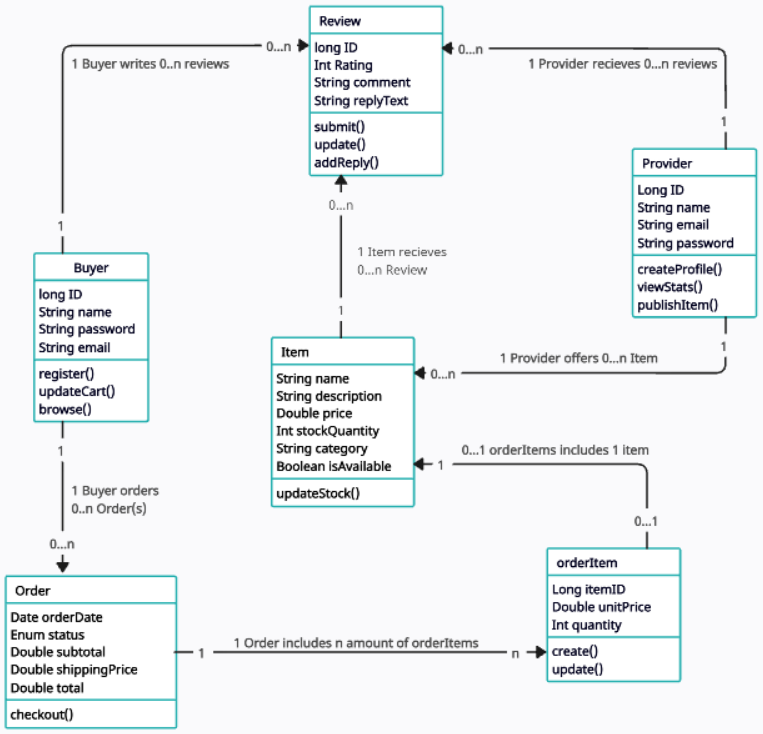

# PrestoPaws Backend API

## UML Diagram



## Endpoints

Customer (Colin Todd)
| Method | Path | Description | Success |
|--------|------|-------------|---------|
| `POST` | `/api/customers` | Create a customer profile | 201 |
| `GET` | `/api/customers` | List all customers | 200 |
| `GET` | `/api/customers/{id}` | Get a specific customer | 200 |
| `POST` | `/api/customers/orders` | Create an order | 201 |
| `GET` | `/api/customers/orders` | List orders | 200 |
| `GET` | `/api/customers/orders/{id}` | Get a specific order | 200 |
| `GET` | `/api/customers/orders/buyer/{buyerId}` | List a customer’s orders | 200 |
| `POST` | `/api/customers/order-items/order/{orderId}` | Add an item to an existing order | 201 |
| `GET` | `/api/customers/order-items` | List all ordered items | 200 |
| `GET` | `/api/customers/order-items/{id}` | Get a specific ordered item | 200 |
| `POST` | `/api/customers/reviews` | Create a review | 201 |

#### `POST /api/customers` example
```json
{
"name": "Alex Buyer",
"email": "alex@example.com",
"password": "example-password"
}
```

#### `POST /api/customers/orders` example
```json
{
"buyerId": 12,
"shippingPrice": 5.00,
"orderItems": [
{ "itemId": 4, "quantity": 2 },
{ "itemId": 9, "quantity": 1 }
]
}
```

#### `POST /api/customers/order-items/order/{orderId}` example
```json
{
"itemId": 4,
"quantity": 2
}
```

#### `POST /api/customers/reviews` example
```json
{
"buyerId": 12,
"itemId": 4,
"rating": 5,
"comment": "Exactly what I was looking for."
}
```


Provider (Sarah Kuyper)
| Method | Path | Description | Success |
|--------|------|-------------|---------|
| `GET` | `/api/providers/reviews` | List reviews | 200 |
| `GET` | `/api/providers/reviews/{id}` | Get a specific review | 200 |
| `GET` | `/api/providers/reviews/item/{itemId}` | List reviews for an item | 200 |
| `GET` | `/api/providers/reviews/provider/{providerId}` | List reviews for a provider | 200 |
| `POST` | `/api/items` | Creates an item | 201 |
| `GET` | `/api/items` | Returns all items | 200 |
| `POST` | `/api/providers` | Creates a provider profile | 201 |
| `GET` | `/api/providers` | List all providers | 200 |
| `GET` | `/api/providers/{id}` | Get a specific provider | 200 |

#### `POST /api/items` example
```json
{
"name": "Paw Balm",
"description": "Moisturizing balm for paws",
"price": 12.99,
"stockQuantity": 25,
"category": "Grooming",
"isAvailable": true,
"imageUrl": "https://example.com/paw-balm.jpg",
"providerId": 3
}
```
#### `POST /api/providers` example
```json
{
"name": "Example Provider",
"email": "provider@example.com",
"password": "example-password"
}
```

There are currently no update or delete endpoints.
